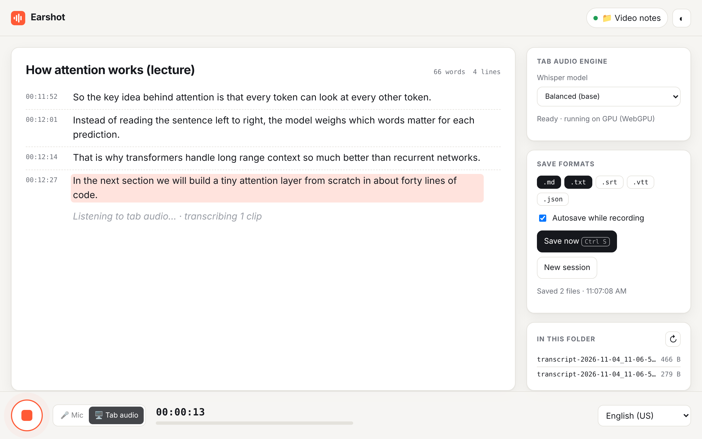
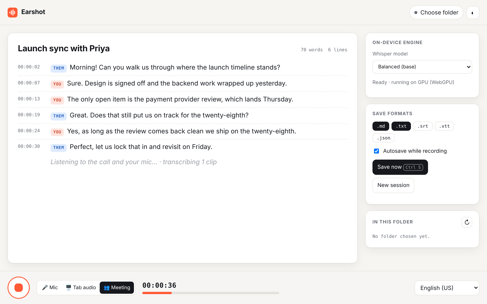

# Earshot — live transcription that saves to your own folder

Earshot is a tiny, dependency-free web app that turns speech into text **live**, from your microphone *or from whatever video is playing in another tab*, and writes the transcript **straight into a folder on your computer**: no accounts, no uploads to a server I run, no build step.

**▶ Live demo: [kevin-mach.github.io/Earshot](https://kevin-mach.github.io/Earshot/)** (best in Chrome or Edge)

[](https://github.com/kevin-mach/Earshot/actions/workflows/ci.yml)


<p align="center"> </p>

## Features

- **Transcribe any video or tab.** Switch to **Tab audio**, pick the tab playing a YouTube video, lecture, podcast or meeting, and Earshot captures its sound directly. You keep hearing it normally. Speech is recognised **on-device** by [Whisper](https://github.com/openai/whisper) running in the browser via [transformers.js](https://github.com/huggingface/transformers.js) on WebGPU (or WebAssembly), so the audio never leaves your computer.
- **Live transcription** with in-progress (interim) text shown in italics as you speak, then committed as timestamped lines.
- **Meeting mode for video calls.** Transcribes a Google Meet, Zoom or Teams call running in a browser tab *and* your microphone at the same time, labelling every line **You** or **Them**. If you're on speakers and your mic re-hears the call, the duplicate lines are dropped automatically.
- **Saves to a real local folder.** Pick any folder once; Earshot remembers it and autosaves every line using the [File System Access API](https://developer.mozilla.org/docs/Web/API/File_System_API). Browsers without it fall back to normal downloads.
- **Five export formats:** Markdown (with a metadata header), plain text, SRT and WebVTT subtitles, and JSON.
- **Edit in place.** Click any line to fix a mis-hearing, or delete it. Edits autosave too.
- **Survives interruptions.** Chrome ends recognition after silence, so Earshot restarts it automatically. The current draft is kept locally and restored on reload.
- **22 languages**, switchable mid-session.
- **Installable PWA.** "Install app" from the address bar and it opens in its own window, with the shell cached by a service worker.
- **Keyboard-first:** <kbd>Space</kbd> starts or stops recording; <kbd>Ctrl/⌘ S</kbd> saves.
- Live mic level meter, light/dark themes, responsive down to phone width, and respects `prefers-reduced-motion`.

## Quick start

```bash
git clone https://github.com/kevin-mach/Earshot.git
cd Earshot
npm start          # serves on http://localhost:5173
```

Open **http://localhost:5173** in Chrome or Edge, click **Choose folder**, then press <kbd>Space</kbd> and talk.

> The microphone only works in a secure context (`https://` or `localhost`), so opening `index.html` straight from disk won't work.

Files are named like `transcript-2026-11-04_10-13-05-weekly-product-sync.md`, using the start time plus a slug of the session title, so each session overwrites only its own files as it autosaves.

## Transcribing a video

1. Open the video in one tab and Earshot in another (or install Earshot as an app).
2. Choose your folder, switch the dock to **🖥️ Tab audio**, then press record.
3. In Chrome's share dialog, pick the video's tab and keep **"Also share tab audio"** switched on.
4. Play the video. Lines appear a few seconds behind it, each stamped with its time, and autosave to your folder.
5. Press stop, or click "Stop sharing" in Chrome. Earshot finishes the last few seconds before saving.



The first time, the Whisper model downloads once (base model: about 80 MB on CPU, about 290 MB on GPU) and is then cached for offline use. Pick **Fast (tiny)** for slower laptops, or **Accurate (small)** for difficult audio. English uses the English-only checkpoint, and other languages use the multilingual one.

## Transcribing a video call (Meeting mode)

1. Join the call **in your browser** (Meet, Zoom web client, or Teams on the web) and **put on headphones**.
2. In Earshot, choose your folder, switch the dock to **👥 Meeting**, and press record.
3. In Chrome's share dialog, choose **Chrome Tab**, pick the call's tab, keep **"Also share tab audio"** on, and click Share.
4. Allow the microphone when asked.
5. Talk normally. Each line is tagged **You** or **Them** and autosaves. Exports keep the labels (`You: …` in text, `<v You>` voice tags in WebVTT).



How it works: the call's audio and your mic run as two independent lanes, each with its own pause detection, feeding one on-device Whisper model. Lines are merged by start time, and a "You" line that is a near-copy of a "Them" line from the same moment is treated as echo and dropped. "Them" is everyone else on the call combined; individual remote speakers aren't separated.

> Let the other participants know you're transcribing. In many places, recording a call requires everyone's consent.

## Browser support

| | Mic transcription | Tab / video audio & Meeting mode | Save to chosen folder |
|---|---|---|---|
| Chrome / Edge (desktop) | ✅ | ✅ | ✅ |
| Safari (macOS) | ✅ | ❌ (no tab audio capture) | ⬇️ downloads instead |
| Firefox | ❌ (no Web Speech API) | ❌ (no tab audio capture) | ⬇️ downloads instead |
| Mobile browsers | ✅ (most) | ❌ | ⬇️ downloads instead |

**Privacy note:** Earshot never sends your audio or text anywhere itself. In **Tab audio** mode, recognition runs fully on your machine. In **Mic** mode, the *browser's* built-in speech engine does the work, and Chrome's implementation streams that audio to Google's speech service. Transcripts themselves only ever live in your folder and your browser's local storage.

## How it works

```
index.html
src/
  app.js         UI controller: session state, timing, autosave, editing, shortcuts
  recognizer.js  Mic source: Web Speech API wrapper with auto-restart + typed events
  tab-source.js  Tab & Meeting sources: getDisplayMedia (+ mic lane) → AudioWorklet (16 kHz) → chunker → Whisper worker
  chunker.js     Energy-based pause detection that cuts the stream into utterances
  whisper-worker.js  On-device Whisper (transformers.js, WebGPU → WASM fallback)
  storage.js     Folder handle persisted in IndexedDB, permission checks, writes, download fallback
  format.js      Pure functions: timestamps, tidy-up, md / txt / srt / vtt / json renderers
sw.js            Network-first app-shell cache (offline + installable)
scripts/serve.mjs  Zero-dependency static server for local dev and tests
```

Some design decisions:

- **No framework, no bundler.** The whole app is native ES modules, so `git clone` is all the setup it needs, and it loads in milliseconds.
- **Pure core, thin shell.** All formatting logic sits in `format.js` with no DOM access, so it's unit-tested in plain Node.
- **Two sources, one interface.** The mic recognizer and the tab transcriber emit the same `interim` / `final` / `error` events, so the transcript, autosave and exports don't care where the speech came from.
- **Cutting audio at natural pauses** keeps Whisper's context sentence-shaped, so it doesn't split words mid-way. Clips with almost no voiced audio are dropped before they reach the model, and sound tags plus Whisper's well-known silence hallucinations ("Thanks for watching!") are filtered out afterwards.
- **Stop never loses the last sentence:** the buffered tail is flushed and the queue drains before the final save.
- **Segment timing** is measured against a pausable session clock: a line starts when its first interim result arrives and ends when it is finalised. That gives subtitle files real cue ranges.
- **Autosave is debounced** (about 900 ms after the last change) and flushed when you stop recording, so a long session doesn't hammer the disk.
- **Persistent folder access:** the `FileSystemDirectoryHandle` is stored in IndexedDB. After a restart the browser asks for permission once with a single click, and the folder chip shows amber until you grant it.

## Tests

```bash
npm test           # unit tests (node:test) for all formatters
npm run test:e2e   # Playwright drives the real app in Chromium
```

The end-to-end suites inject a **scripted fake speech engine**, a **synthetic "tab"** that plays bursts of tone separated by pauses, a stand-in Whisper worker, and an **in-memory folder** before the page loads. The tab test drives the real capture → AudioWorklet → chunker → worker → transcript → autosave pipeline, so only the neural network itself is faked. It then checks the full flow: speech becomes lines, lines autosave to `.md` and `.txt`, edits and newly enabled formats show up in the next save, drafts survive a reload, and unsupported browsers get a clear message instead of a crash. CI runs both suites on every push, and GitHub Pages deploys the app.

## Roadmap ideas

- Transcribe a local video or audio file by dropping it onto the page
- Use on-device Whisper for the mic too, for fully private recording
- Speaker labels and paragraph grouping by pause length
- Open and continue an existing transcript from the folder

## License

MIT © Kevin Mach
