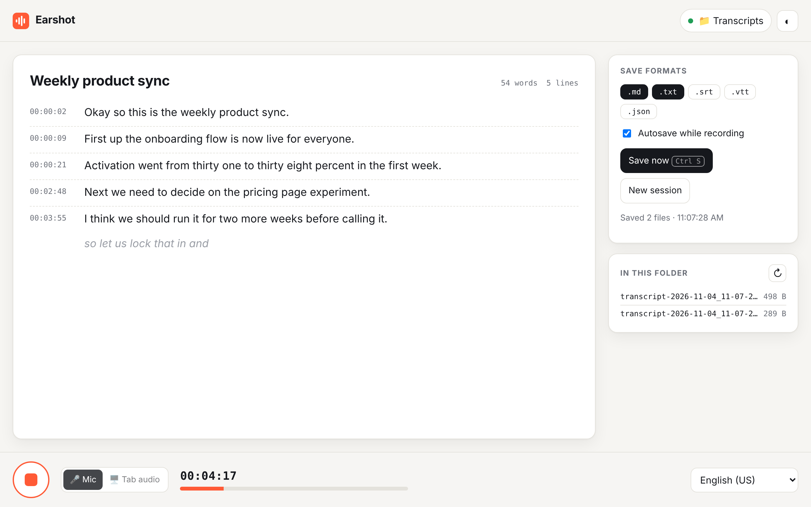
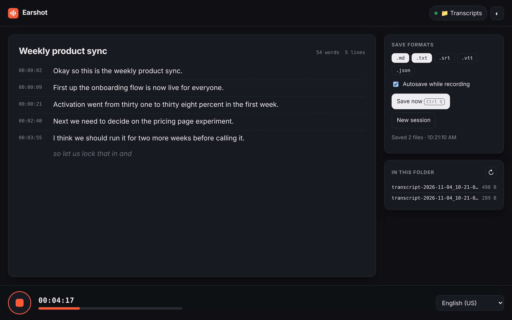
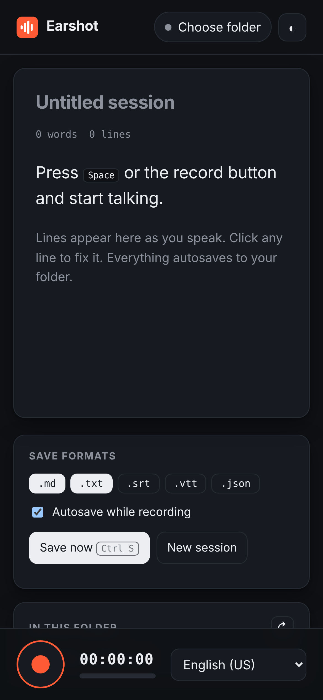

# Earshot — live transcription that saves to your own folder

Earshot is a tiny, dependency-free web app that turns speech into text **as you talk** and writes the transcript **straight into a folder on your computer**: no accounts, no uploads to a server I run, no build step.



<p align="center"> </p>

## Features

- **Live transcription** with in-progress (interim) text shown in italics as you speak, then committed as timestamped lines.
- **Saves to a real local folder.** Pick any folder once; Earshot remembers it and autosaves every line using the [File System Access API](https://developer.mozilla.org/docs/Web/API/File_System_API). Browsers without it fall back to normal downloads.
- **Five export formats:** Markdown (with a metadata header), plain text, SRT and WebVTT subtitles, and JSON.
- **Edit in place.** Click any line to fix a mis-hearing, or delete it. Edits autosave too.
- **Survives interruptions.** Chrome ends recognition after silence, so Earshot restarts it automatically. The current draft is kept locally and restored on reload.
- **22 languages**, switchable mid-session.
- **Installable PWA.** "Install app" from the address bar and it opens in its own window, with the shell cached by a service worker.
- **Keyboard-first:** <kbd>Space</kbd> starts or stops recording; <kbd>Ctrl/⌘ S</kbd> saves.
- Live mic level meter, light/dark themes, responsive down to phone width, and respects `prefers-reduced-motion`.

## Quick start

```bash
git clone https://github.com/kevin-mach/Earshot.git
cd Earshot
npm start          # serves on http://localhost:5173
```

Open **http://localhost:5173** in Chrome or Edge, click **Choose folder**, then press <kbd>Space</kbd> and talk.

> The microphone only works in a secure context (`https://` or `localhost`), so opening `index.html` straight from disk won't work.

Files are named like `transcript-2026-11-04_10-13-05-weekly-product-sync.md`, using the start time plus a slug of the session title, so each session overwrites only its own files as it autosaves.

## Browser support

| | Live transcription | Save to chosen folder |
|---|---|---|
| Chrome / Edge (desktop) | ✅ | ✅ |
| Safari (macOS / iOS) | ✅ | ⬇️ downloads instead |
| Firefox | ❌ (no Web Speech API) | ⬇️ downloads instead |

**Privacy note:** Earshot never sends your audio or text anywhere itself. The *browser's* built-in speech engine does the recognition, though, and Chrome's implementation streams audio to Google's speech service. Transcripts themselves only ever live in your folder and your browser's local storage.

## How it works

```
index.html
src/
  app.js         UI controller: session state, timing, autosave, editing, shortcuts
  recognizer.js  Web Speech API wrapper with auto-restart + typed events
  storage.js     Folder handle persisted in IndexedDB, permission checks, writes, download fallback
  format.js      Pure functions: timestamps, tidy-up, md / txt / srt / vtt / json renderers
sw.js            Network-first app-shell cache (offline + installable)
scripts/serve.mjs  Zero-dependency static server for local dev and tests
```

Some design decisions:

- **No framework, no bundler.** The whole app is native ES modules, so `git clone` is all the setup it needs, and it loads in milliseconds.
- **Pure core, thin shell.** All formatting logic sits in `format.js` with no DOM access, so it's unit-tested in plain Node.
- **Segment timing** is measured against a pausable session clock: a line starts when its first interim result arrives and ends when it is finalised. That gives subtitle files real cue ranges.
- **Autosave is debounced** (about 900 ms after the last change) and flushed when you stop recording, so a long session doesn't hammer the disk.
- **Persistent folder access:** the `FileSystemDirectoryHandle` is stored in IndexedDB. After a restart the browser asks for permission once with a single click, and the folder chip shows amber until you grant it.

## Tests

```bash
npm test           # unit tests (node:test) for all formatters
npm run test:e2e   # Playwright drives the real app in Chromium
```

The end-to-end suite injects a **scripted fake speech engine** and an **in-memory folder** before the page loads. It then checks the full flow: speech becomes lines, lines autosave to `.md` and `.txt`, edits and newly enabled formats show up in the next save, drafts survive a reload, and unsupported browsers get a clear message instead of a crash. CI runs both suites on every push, and GitHub Pages deploys the app.

## Roadmap ideas

- Offline, on-device recognition with Whisper via WebGPU (`transformers.js`) for Firefox and fully private use
- Speaker labels and paragraph grouping by pause length
- Open and continue an existing transcript from the folder

## License

MIT © Kevin Mach
